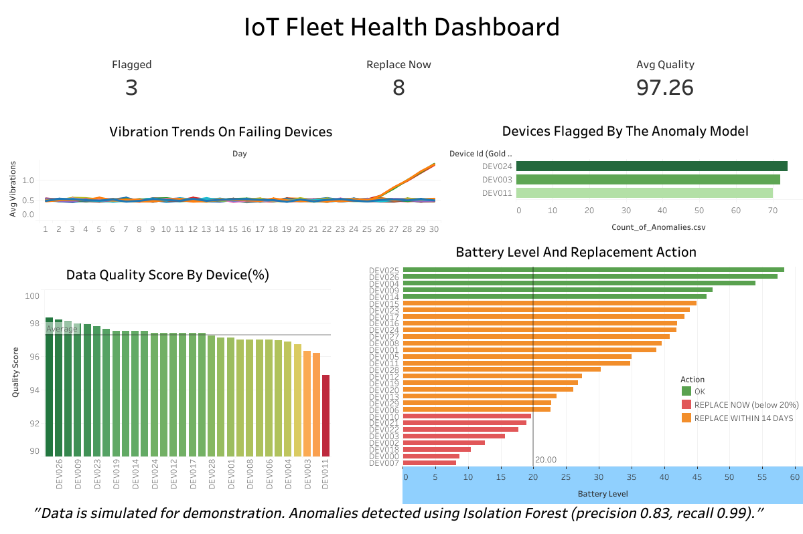
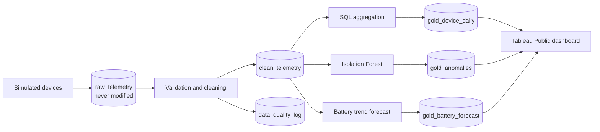
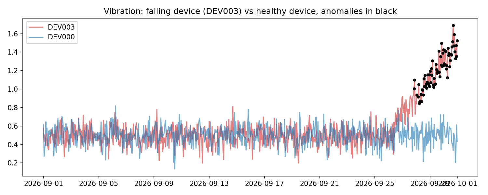
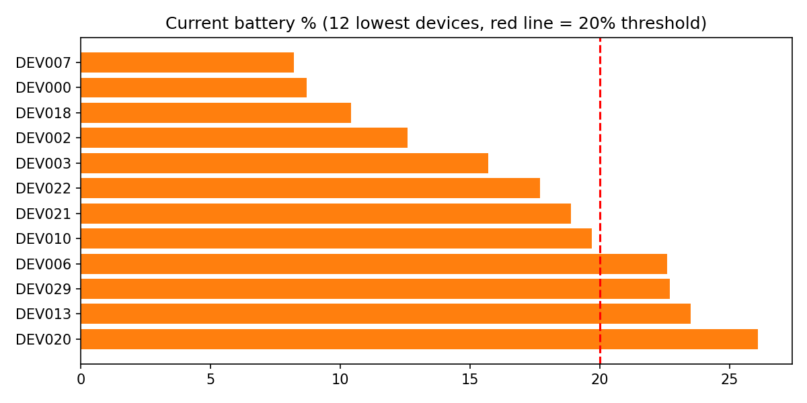
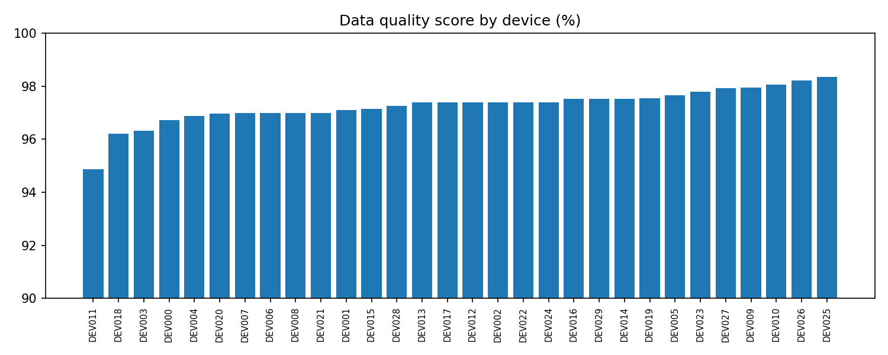

# IoT Sensor Data Platform: Governance, Quality & Predictive Analytics



An end-to-end data project that simulates telemetry from 30 IoT devices (temperature, vibration, battery, signal strength), builds a governed data pipeline, detects failing devices and forecasts battery replacement.

**Built with:** Python (pandas, scikit-learn, matplotlib), SQL (SQLite), Tableau Public, Google Colab

**Note on data:** The telemetry is simulated. I generated it deliberately so I could inject known faults and device failures, then measure whether the pipeline and model catch them.

**Run it yourself?**
[](https://colab.research.google.com/github/damianrolivier/iot_data_governance_platform/blob/main/iot_data_platform.ipynb)


## Business problem
IoT companies that ship sensor products (wireless and wired) depend on trustworthy field data. Field data is messy: devices drop readings, send impossible values and duplicate messages. This project answers three questions:
1. **Can we trust the data?** (quality checks, governance, lineage)
2. **Which devices are failing?** (anomaly detection)
3. **When should we replace batteries?** (predictive maintenance)

## Architecture



## What I did
| Stage | Detail |
|---|---|
| Ingestion | 21,900 raw rows loaded as received, with a load timestamp |
| Cleaning | Removed 300 duplicates, nulled 60 impossible temperatures and 40 invalid battery values, interpolated gaps and **flagged every imputed value** |
| Quality checks | 7 automated pass/fail tests on the clean layer; per-device quality score |
| Governance | Data dictionary, lineage table, ownership roles, retention policy (below) |
| Analytics | SQL daily aggregates per device (gold layer); built an iot fleet health dashboard from the simulated data |
| Data science | Isolation Forest anomaly detection, evaluated against known failures; linear battery depletion forecast |

## Results
- Anomaly model: **precision ~0.83, recall ~0.99** on simulated failures (DEV003, DEV011, DEV024 flagged correctly)
- 8 devices already below 20% battery, 17 more within 14 days
- Device data-quality scores ranged from ~95% to ~98%





**IoT Fleet Health Dashboard:** [IoT Fleet Health: Data Quality, Anomalies & Predictive Maintenance](https://public.tableau.com/views/IotFleetHealthDashboard/IoT_Fleet_Health_Dashboard)


## Data governance framework
**Roles**
- *Data Engineer:* owns pipelines and raw/clean layers
- *Data Steward:* owns definitions, valid ranges and quality rules
- *Data Scientist:* owns models, documents assumptions
- *Consumers:* read-only access to the gold layer

**Principles (aligned with ISO 9001 ideas of traceability and continual improvement)**
- Raw data is immutable; all changes are logged and reproducible
- Every imputed value is flagged, never silently altered
- Quality rules are versioned code, and failures are logged with timestamps
- Metadata (dictionary, lineage) is stored alongside the data

**Retention policy (example):** raw data 24 months, clean data 24 months, gold aggregates 5 years, quality logs 5 years.

**Access control (example):** raw layer restricted to engineers; gold layer open to analysts. In production, device IDs linked to customers would be classed as confidential (POPIA).

## Limitations and next steps
- Data is simulated; real telemetry would need streaming ingestion (MQTT/Kafka)
- Linear battery model ignores temperature effects; try survival analysis
- Version 2: PostgreSQL, Airflow scheduling, Docker, Great Expectations, drift monitoring

## How to run
1. Click the badge to open the notebook in Google Colab [](https://colab.research.google.com/github/damianrolivier/iot_data_governance_platform/blob/main/iot_data_platform.ipynb) 
2. Runtime > Run all (about 1 minute)
3. Outputs: `iot_platform.db`, CSVs in `exports/`, charts in `outputs/`

## Repository structure
```
iot_data_governance_platform/
├── README.md
├── iot_data_platform.ipynb
├── outputs/        (charts)
├── exports/        (CSVs for Tableau, data dictionary, lineage)
├── data/           (iot_platform.db, raw_telemetry.csv)
└── assets/         (dashboard.png)
```

## About me
From discovering the power of data analytics to exploring data engineering and data science, I am continually expanding my skills and pushing beyond the boundaries of what I know to turn data into insight, innovation, and real-world solutions.

Connect with me on LinkedIn?
[Damian Ricardo Olivier](https://www.linkedin.com/in/damian-olivier-98b92b405)